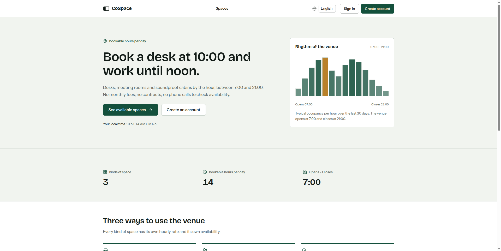

<h1 align="center">
  CoSpace
</h1>

<p align="center">
  
  
  
  
  
  
  
  
  
  
  
</p>

<p align="center">
  
</p>

<p align="center">
  <a href="./README.es.md">Español</a> | <strong>English</strong>
</p>

CoSpace is a full-stack web application for booking coworking spaces by the hour. It includes a public catalog, daily availability, secure authentication with access and refresh tokens, a personal booking dashboard, and an administration panel for managing spaces, bookings, and cancellations.

## Tech stack

- Next.js 16 with the App Router, React 19, and TypeScript.
- Tailwind CSS 4 with reusable UI components.
- Prisma 7 with PostgreSQL and the `@prisma/adapter-pg` driver adapter.
- Supabase as the managed PostgreSQL database in production.
- `next-intl` for Spanish and English.
- Cloudflare Turnstile on the login and registration forms.
- JWT HS256 access tokens and opaque refresh tokens stored as SHA-256 hashes.
- Vitest for business-rule tests.
- A multi-stage Docker image and GitHub Actions for continuous integration.

## Requirements

- Node.js 20.9 or newer.
- Bun 1.4.4. The repository pins this version in `packageManager`.
- PostgreSQL 16 or a Supabase project.
- A Cloudflare account for the production Turnstile widget. Local development can use the official test keys.
- Docker and Docker Compose only if you use the container workflow. They are not required for local development.

### Install Bun

If `bun` is not installed, run the official installer:

```bash
curl -fsSL https://bun.sh/install | bash
```

Reload your shell configuration and verify the installation:

```bash
source ~/.zshrc
bun --version
```

If you use Bash, run `source ~/.bashrc` instead. If the command still cannot be found, add the Bun binary directory to your `PATH`:

```bash
echo 'export BUN_INSTALL="$HOME/.bun"' >> ~/.zshrc
echo 'export PATH="$BUN_INSTALL/bin:$PATH"' >> ~/.zshrc
source ~/.zshrc
```

On Windows, use PowerShell:

```powershell
powershell -c "irm bun.sh/install.ps1 | iex"
```

You can also install Bun with Homebrew (`brew install oven-sh/bun/bun`) or npm (`npm install -g bun`). Verify with `bun --version` before continuing.

## Environment setup

1. Install dependencies:

   ```bash
   bun install
   ```

2. Create the environment file:

   ```bash
   cp .env.example .env
   ```

3. Fill in the variables:

   | Variable | Required | Description |
   | --- | --- | --- |
   | `DATABASE_URL` | Yes | PostgreSQL connection string. In Supabase, use the Session pooler URI. |
   | `JWT_ACCESS_SECRET` | Yes | Secret of at least 32 characters used to sign access tokens. |
   | `JWT_REFRESH_SECRET` | Yes | Secret of at least 32 characters reserved for refresh-token material. |
   | `NEXT_PUBLIC_TURNSTILE_SITE_KEY` | Yes | Public Cloudflare Turnstile site key embedded in the login and registration forms. |
   | `TURNSTILE_SECRET_KEY` | Yes | Server-only Cloudflare Turnstile secret used to verify tokens. |
   | `ACCESS_TOKEN_EXPIRES_IN` | No | Access token lifetime. Defaults to `15m`. |
   | `REFRESH_TOKEN_EXPIRES_IN` | No | Refresh token lifetime. Defaults to `7d`. |
   | `NEXT_PUBLIC_APP_URL` | No | Public application URL. Defaults to `http://localhost:3000`. |
   | `NEXT_PUBLIC_VENUE_TIMEZONE` | No | Venue time zone. Defaults to `America/Bogota`. |
   | `NEXT_PUBLIC_VENUE_CURRENCY` | No | ISO-4217 currency. Defaults to `COP`. |
   | `SEED_ADMIN_EMAIL` | No | Email of the administrator created by the seed. |
   | `SEED_ADMIN_PASSWORD` | No | Password of the administrator created by the seed. |
   | `SEED_ADMIN_NAME` | No | Display name of the administrator created by the seed. |

4. Generate the secrets:

   ```bash
   openssl rand -hex 32
   ```

5. Generate the Prisma client. This step is required in a clean clone because `src/server/db/generated` is ignored by Git:

   ```bash
   bun run db:generate
   ```

6. Apply the migrations and load the initial catalog:

   ```bash
   bun run db:migrate
   bun run db:seed
   ```

7. Start the development server:

   ```bash
   bun run dev
   ```

The application is available at `http://localhost:3000`.

### Cloudflare Turnstile

Login and registration require a Turnstile token. The token is verified on the server before the credentials or the new account are processed.

1. Open the [Cloudflare dashboard](https://dash.cloudflare.com) and go to **Turnstile**.
2. Add a widget for the site.
3. Add `localhost` for development and the production hostname.
4. Copy the site key into `NEXT_PUBLIC_TURNSTILE_SITE_KEY` and the secret key into `TURNSTILE_SECRET_KEY`.

For local development, use the official test keys instead of creating a widget:

```dotenv
NEXT_PUBLIC_TURNSTILE_SITE_KEY=1x00000000000000000000AA
TURNSTILE_SECRET_KEY=1x0000000000000000000000000000000AA
```

The site key is public and is embedded into the pages at build time. The secret key stays on the server: never expose it with a `NEXT_PUBLIC_` prefix. The test keys always pass and must not be used in production.

## Administrator account

The seed creates an administrator with these defaults:

- Email: `admin@cospace.dev`
- Password: `Admin1234!`
- Name: `Ada Restrepo`

You can change them with `SEED_ADMIN_EMAIL`, `SEED_ADMIN_PASSWORD`, and `SEED_ADMIN_NAME` before running `bun run db:seed`. The seed is idempotent: running it again updates the administrator password with the environment value.

The seed also creates eight example spaces: four desks, two meeting rooms, and two cabins.

## Business rules

- Bookings start and end on whole hours of the venue clock.
- The minimum duration is one hour and the maximum is four hours.
- Opening hours are 07:00 to 21:00. A booking cannot end after 21:00 or cross midnight.
- A space cannot have two confirmed bookings that overlap.
- A user cannot have two confirmed bookings that overlap, even on different spaces.
- Each user can have at most three confirmed future bookings.
- Deactivated spaces cannot be booked.
- Bookings cannot be made in the past or more than thirty days in advance.
- Only the reservation owner or an administrator can cancel a booking.
- The owner must cancel at least two hours before the start time. An administrator can cancel without that notice.
- Cancelling only changes the reservation status; it never deletes the row or removes the history.
- The price is always calculated on the server using the current hourly price of the space.
- Spaces are never deleted; they are deactivated. A space with confirmed bookings that have not ended cannot be deactivated.
- The `Idempotency-Key` header makes reservation creation repeatable and can only be reused by the account that created it.

Reservation rules live in `src/server/domain/reservation-policy.ts`, and space lifecycle rules live in `src/server/domain/space-policy.ts`. Critical booking checks run inside a `SERIALIZABLE` transaction with retries, so concurrent requests cannot bypass the overlap, quota, or active-space rules.

## Scripts

| Script | Description |
| --- | --- |
| `bun run dev` | Start the development server. |
| `bun run build` | Generate Prisma and build the application for production. |
| `bun run start` | Serve the production build. |
| `bun run lint` | Run ESLint. |
| `bun run typecheck` | Check TypeScript without emitting files. |
| `bun run test` | Run the Vitest suite once. |
| `bun run test:watch` | Run Vitest in watch mode. |
| `bun run db:generate` | Generate the Prisma client. |
| `bun run db:migrate` | Apply pending migrations with `prisma migrate deploy`. |
| `bun run db:migrate:dev` | Create or apply development migrations with `prisma migrate dev`. |
| `bun run db:seed` | Load the administrator and the example catalog. |
| `bun run db:studio` | Open Prisma Studio. |

## Tests

```bash
bun run test
```

The suite covers duration, opening hours, advance-window, overlap, quota, cancellation, space-state, and public image-path rules, plus Turnstile verification and authentication payload validation. It does not need a database.

## Docker

### Production image

The image uses Bun and a multi-stage build. `NEXT_PUBLIC_*` variables are embedded in the bundle at build time; secrets are provided at runtime. The Turnstile site key is public but must be passed as a build argument, while `TURNSTILE_SECRET_KEY` comes from the runtime environment file.

```bash
docker build \
  --build-arg NEXT_PUBLIC_TURNSTILE_SITE_KEY=your-site-key \
  --build-arg NEXT_PUBLIC_APP_URL=https://your-domain.example \
  --build-arg NEXT_PUBLIC_VENUE_TIMEZONE=America/Bogota \
  --build-arg NEXT_PUBLIC_VENUE_CURRENCY=COP \
  -t cospace .

docker run --rm \
  --env-file .env \
  -p 3000:3000 \
  cospace
```

The container listens on `0.0.0.0:3000`. If `DATABASE_URL` points to a PostgreSQL instance running on the host, use an address reachable from the container or the Docker Compose workflow.

### Docker Compose

The `docker-compose.yml` file starts PostgreSQL on port `5433` and the application on port `3000`. The application overrides `DATABASE_URL` to point to the `db` service, so you do not need to change `.env` for this workflow. Make sure both Turnstile keys are set in `.env` before building the application image.

```bash
cp .env.example .env
docker compose up -d db
docker compose run --rm app bun run db:generate
docker compose run --rm app bun run db:migrate
docker compose run --rm app bun run db:seed
docker compose up --build -d app
```

View the logs:

```bash
docker compose logs -f app
```

Stop and remove the containers:

```bash
docker compose down
```

The `cospace-postgres` volume keeps the data. Use `docker compose down -v` only when you want to delete the local database.

## Deployment

### Supabase

1. Create a Supabase project.
2. Copy the Session pooler connection string from `Project settings > Database`.
3. Set `DATABASE_URL` to that string.
4. Run the migrations and the seed from an environment with database access:

   ```bash
   DATABASE_URL="postgresql://..." bun run db:migrate
   DATABASE_URL="postgresql://..." bun run db:seed
   ```

### Vercel

1. Import the repository into Vercel.
2. Configure the project environment variables:
   - `DATABASE_URL`
   - `JWT_ACCESS_SECRET`
   - `JWT_REFRESH_SECRET`
   - `NEXT_PUBLIC_TURNSTILE_SITE_KEY`
   - `TURNSTILE_SECRET_KEY`
   - `ACCESS_TOKEN_EXPIRES_IN`
   - `REFRESH_TOKEN_EXPIRES_IN`
   - `NEXT_PUBLIC_APP_URL`
   - `NEXT_PUBLIC_VENUE_TIMEZONE`
   - `NEXT_PUBLIC_VENUE_CURRENCY`
   - `SEED_ADMIN_EMAIL`
   - `SEED_ADMIN_PASSWORD`
   - `SEED_ADMIN_NAME`
3. Use `bun run build` as the build command.
4. Deploy and update `NEXT_PUBLIC_APP_URL` with the final URL.
5. Run `bun run db:migrate` against the production database before opening the site.

### Application URL

- Local development: `http://localhost:3000`
- Production: pending. There is no public URL in the repository because the development environment does not have Vercel or deployment-provider credentials. After deploying, replace this line with the final URL.

## Project structure

```text
src/                    Application source
  app/                  Next.js routes, layouts, and route handlers
    [locale]/           Public, private, and administration pages
    api/                REST endpoints
  components/           UI components
    admin/              Administration form and table
    auth/               Login, registration, and Turnstile widget
    booking/            Booking form
    layout/             Navigation and footer
    reservations/       User booking dashboard
    session/            Browser session context
    ui/                 Base components
  i18n/                 Language configuration
  lib/                  Shared utilities and domain contracts
  messages/             English and Spanish translations
  server/               Domain, services, security, HTTP, and database code
  tests/                Business-rule tests
  proxy.ts              Private-route guard and locale routing
prisma/                 Schema, migrations, and seed
public/                 Static assets and space illustrations
Dockerfile              Production image
docker-compose.yml      PostgreSQL and application for local development
```

## Security

- Passwords are stored with bcrypt and never returned in responses.
- Refresh tokens are opaque, stored hashed, and rotated when the session is renewed.
- Authentication cookies are `httpOnly`, `sameSite=lax`, and `secure` in production.
- The proxy protects `/dashboard` and `/admin`; the backend checks the session and role again on every endpoint.
- Login and registration require a Cloudflare Turnstile token verified on the server.
- Login attempts are rate-limited per client address and email.
- API errors use stable codes and are translated on the client; internal details are only written to logs.
- Reservation creation requires an `Idempotency-Key` from the UI, and the key is bound to the user who created it.

## CI

`.github/workflows/ci.yml` installs dependencies, generates Prisma, applies migrations against an ephemeral PostgreSQL instance, and runs `typecheck`, `lint`, `test`, and `build` on every push and pull request.